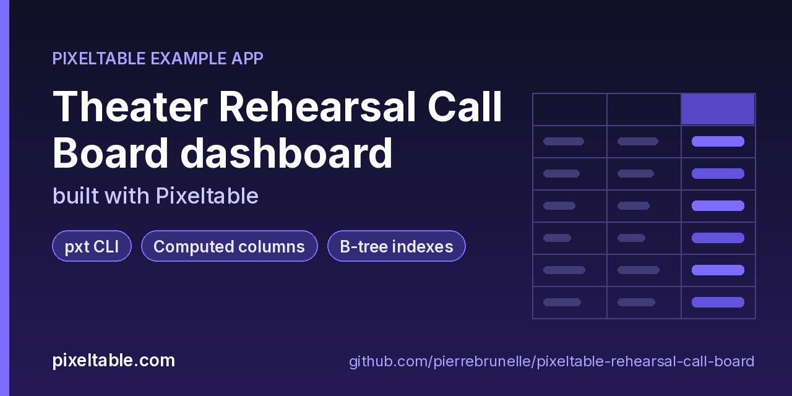

<!-- pixeltable-example-app: 20261024-rehearsal-call-board -->
# Theater Rehearsal Call Board dashboard built with Pixeltable



[](https://codespaces.new/pierrebrunelle/pixeltable-rehearsal-call-board?quickstart=1)
[](https://pixeltable.com)
[](https://pypi.org/project/pixeltable/)
[](https://github.com/pixeltable/pixeltable)
[](LICENSE)

`Cast`, `Scenes`, `Rehearsals` and `Attendance` are TableModel classes in `app.py`. Each rehearsal call stores its scenes and its department notes as JSON lists; computed columns derive the call length (`hours_between` UDF), the urgent notes (`filter`), the departments that left notes (`map`), the notes ranked by priority (`sort`) and the top note. Each check-in gets a punctuality band (on time / grace / late / absent). `dashboard.py trace` runs a stage manager's day (log tonight's call and check-ins, fix a late time, read the reports, clean up) with Pixeltable's OpenTelemetry bridge on: every span goes to `output/spans.jsonl` and then into the `Spans` table, which has its own computed columns (duration, span family, table name). `dashboard.py build` writes a Markdown and HTML dashboard: hours by room, punctuality per company member and absences by call (two- and three-way joins with the cast), who has never been called (a left join), urgent notes, calls whose computed hours failed (`errortype` / `errormsg`), and span timings with a p95 UDA.

[Pixeltable](https://pixeltable.com) is open-source, Python-native **multimodal AI data infrastructure**: tables, incremental computed columns, UDFs, indexes and serving in one library, running locally or on Pixeltable Cloud.

> ⭐ **Like this example?** Star [pixeltable/pixeltable](https://github.com/pixeltable/pixeltable) on GitHub. It helps other developers find it.

## What this example shows

- **Incremental computed columns** powered by plain Python UDFs (`@pxt.udf`)
- **B-tree indexes** declared on the model (`__indexes__`) back the lookup queries
- **Importable UDF module**: UDFs live in `udfs.py`; tables and queries live in `app.py` (Pixeltable resolves UDFs by module path)
- **`pixeltable.toml`** declares a local database and a **Pixeltable Cloud** database, so the same code deploys with `pxt db update`

## What is in the dashboard

| Section | Built with |
|---|---|
| Rehearsal hours by room | `group_by(room)` with `count`, `sum`, `mean`, `min`, `max` over a computed `hours` column |
| Punctuality per company member | `Attendance.join(Cast)` + `group_by` |
| Absences and late arrivals by call | three-way join `Attendance` -> `Cast` -> `Rehearsals` filtered on the punctuality band |
| Who has never been called | `Cast.join(Attendance, how='left')` keeping the rows whose join key is null |
| Urgent notes per call | `filter`, `map` and `sort` over the JSON `notes` list, stored as computed columns |
| Data health | `errortype` / `errormsg` of the `hours` column (one call has `23:O0` as its end time) |
| Pixeltable operations | OpenTelemetry spans grouped by name, with a `p95` UDA |
| Traces | one root span per Pixeltable operation, with the table it touched |

## Tracing with OpenTelemetry

`pip install 'pixeltable[otel]'` installs the bridge. `dashboard.py` calls `init(span_dump=..., span_level='debug')`, which writes one JSON span per line with no collector. To also ship spans to Grafana, Langfuse, Honeycomb or any OTLP backend, set `OTEL_EXPORTER_OTLP_ENDPOINT` (and `OTEL_EXPORTER_OTLP_HEADERS`), or put an `[otel]` section in `~/.pixeltable/config.toml`. Root spans are the public operations (`pixeltable.insert`, `pixeltable.update`, `pixeltable.collect`, ...); at `span_level='debug'` the catalog and store steps underneath show up too.

## Pixeltable Cloud

Run `pxt db update`, then `pxt schema update app.py pxt://<your-org>:<your-db>` and `python seed.py pxt://<your-org>:<your-db>`. `dashboard.py` takes `THEATER_CATALOG=pxt://<your-org>:<your-db>`.

## Gotchas

- In a left join, filter on the join key (`Attendance.actor_id == None`) to find unmatched rows; filters on other right-side columns are not reliable there yet.
- `order_by` on an aggregate in the same `group_by` as a Python UDA is rejected; this app sorts the span table in Python.
- `pixeltable.functions` has no `cast`: use `.astype(pxt.Int)`.
- Insert spans carry `pxt.table_id`, not `pxt.table`; update and delete spans carry `pxt.table`.

## What's inside

| File | What it is |
|------|------------|
| `.devcontainer/devcontainer.json` | GitHub Codespaces / Dev Container config: Python 3.12, installs `requirements.txt` |
| `.github/social-preview.png` | Social preview image (1280x640) |
| `CITATION.cff` | Citation metadata (authors, license, release date, keywords) |
| `app.py` | Tables declared as Python classes and `@pxt.query` functions |
| `dashboard.py` | Rehearsal call board: trace a workload with OpenTelemetry, then build the dashboard |
| `pixeltable.toml` | Project config: the local database plus a Pixeltable Cloud database (sizing, deploy excludes) |
| `seed.py` | Seed the call board: 10 company members, 8 scenes, 9 rehearsal calls and their check-ins |
| `udfs.py` | Pixeltable UDFs (`@pxt.udf`) in their own importable module, imported by `app.py` |
| `requirements.txt` / `pyproject.toml` | Dependencies (`pixeltable>=0.7.20`) |

**Tables**

| Table | Stored columns | Computed columns |
|-------|---------|------------------|
| `cast` | `actor_id`, `name`, `character`, `track`, `equity` | - |
| `scenes` | `scene_id`, `act`, `title`, `run_minutes`, `called` | - |
| `rehearsals` | `rehearsal_id`, `day`, `room`, `start`, `end`, `scenes`, `notes` | `hours`, `urgent_notes`, `note_depts`, `notes_ranked`, `top_note`, `n_scenes` |
| `attendance` | `checkin_id`, `rehearsal_id`, `actor_id`, `status`, `minutes_late` | `band` |
| `spans` | `span_id`, `trace_id`, `parent_id`, `name`, `start_time`, `end_time`, `status`, `attributes`, `run` | `duration_ms`, `family`, `pxt_table` |

## Run in your browser (GitHub Codespaces)

[](https://codespaces.new/pierrebrunelle/pixeltable-rehearsal-call-board?quickstart=1)

1. Click **Open in GitHub Codespaces** above (or [this link](https://codespaces.new/pierrebrunelle/pixeltable-rehearsal-call-board?quickstart=1)). The dev container installs Python 3.12 and `pixeltable>=0.7.20` from `requirements.txt`.
2. In the codespace terminal, create the tables, seed them and run the app:

   ```bash
   pxt schema update app.py theater
   python seed.py              # 10 company members, 8 scenes, 9 rehearsal calls (one with a typo'd end time), 57 check-ins
   python dashboard.py trace   # run a stage manager's day with OpenTelemetry on; spans land in theater/spans
   python dashboard.py build   # writes output/dashboard.md and output/dashboard.html
   pxt errors theater/rehearsals --col hours   # the call whose end time failed to parse
   ```


## Quickstart

Requires Python 3.11+ and `pixeltable>=0.7.20`.

```bash
git clone https://github.com/pierrebrunelle/pixeltable-rehearsal-call-board.git
cd pixeltable-rehearsal-call-board
python -m venv .venv && source .venv/bin/activate
pip install -r requirements.txt

# Create the tables in a local catalog directory named `theater`
pxt schema update app.py theater

python seed.py              # 10 company members, 8 scenes, 9 rehearsal calls (one with a typo'd end time), 57 check-ins
python dashboard.py trace   # run a stage manager's day with OpenTelemetry on; spans land in theater/spans
python dashboard.py build   # writes output/dashboard.md and output/dashboard.html
pxt errors theater/rehearsals --col hours   # the call whose end time failed to parse
```

## Deploy to Pixeltable Cloud

The same `app.py` runs on [Pixeltable Cloud](https://pixeltable.com). Sign in (or get a free trial database with `pxt new`), point the second database entry in `pixeltable.toml` at your own database, then deploy:

```bash
pxt login                       # or: export PIXELTABLE_API_KEY=<your-api-key>
# edit pixeltable.toml: name = 'pxt://<your-org>:<your-db>'
pxt db update pxt://<your-org>:<your-db>                 # build the image and upload the project
pxt schema update app.py pxt://<your-org>:<your-db>       # create the tables at the database root (no per-app folder)
```

Keep keys in environment variables or `pxt secret set`, never in code.

## Code walkthrough

**1. Business logic is plain Python, in `udfs.py`.** A `@pxt.udf` function can be used as a column expression. Pixeltable records UDFs by module path (`udfs.hours_between`), so they live in their own importable module rather than inline in the app: the daemon, serving workers and Pixeltable Cloud import it again by that path.

```python
# udfs.py
@pxt.udf
def hours_between(start: str, end: str) -> float:
    """Length of a rehearsal call in hours from 'HH:MM' strings; raises on a malformed time."""
    t0 = dt.datetime.strptime(start, '%H:%M')
    t1 = dt.datetime.strptime(end, '%H:%M')
    if t1 <= t0:
        raise ValueError(f'call ends ({end}) before it starts ({start})')
    return round((t1 - t0).total_seconds() / 3600, 2)
```

**2. Tables are Python classes (`app.py`).** Annotated attributes are stored columns; attributes assigned an expression are **computed columns** (`hours`, `urgent_notes`, `note_depts`, `notes_ranked`, `top_note`, `n_scenes`), evaluated incrementally on every insert or update and recomputed when their inputs change. Indexes live next to the columns.

```python
# app.py
class Rehearsals(TableModel, name='rehearsals'):
    """One rehearsal call: room, times, scenes worked and the production notes from it."""

    rehearsal_id = pxt.Column(type=pxt.String, primary_key=True)
    day: pxt.String
    room: pxt.String
    start: pxt.String
    end: pxt.String
    scenes: pxt.Json  # list of scene_ids
    notes: pxt.Json  # list of {dept, note, priority}

    hours = hours_between(start, end)
    urgent_notes = pxtf.filter(notes, lambda x: x.priority >= 2)
    note_depts = pxtf.map(notes, lambda x: x.dept)
    notes_ranked = pxtf.sort(notes, key=lambda x: x.priority, asc=False)
    top_note = notes_ranked[0].note.astype(pxt.String | None)
    n_scenes = scenes.len().astype(pxt.Int)

    __indexes__ = [pxt.BtreeIndex(day), pxt.BtreeIndex(room)]
```

**3. Queries are functions (`app.py`).** `@pxt.query` wraps a Pixeltable query so it can be called from Python or exposed as a route:

```python
# app.py
@pxt.query
def checkins(actor_id: str):
    """Every check-in of one company member (the dashboard joins these with the calls)."""
    return (
        Attendance.where(Attendance.actor_id == actor_id)
        .order_by(Attendance.rehearsal_id)
        .select(Attendance.rehearsal_id, Attendance.band, Attendance.minutes_late)
    )
```

## Learn more

- 🌐 Website: https://pixeltable.com
- 📚 Docs: https://docs.pixeltable.com
- 💻 Source: https://github.com/pixeltable/pixeltable (⭐ star it if Pixeltable is useful to you)
- 📦 PyPI: https://pypi.org/project/pixeltable/
- 🧩 More example apps: https://pierrebrunelle.github.io/awesome-pixeltable-apps/

**[More Pixeltable example apps →](https://pierrebrunelle.github.io/awesome-pixeltable-apps/)**

---

<sub>Built as part of a daily series of Pixeltable example apps · Pixeltable 0.7.20 · Python, incremental computed columns · Licensed under Apache-2.0.</sub>
